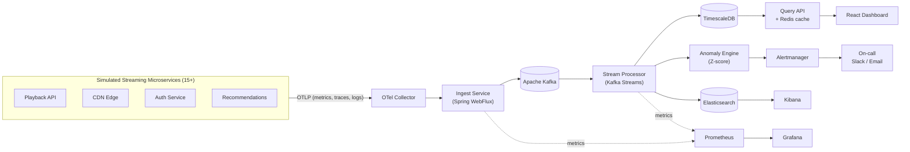
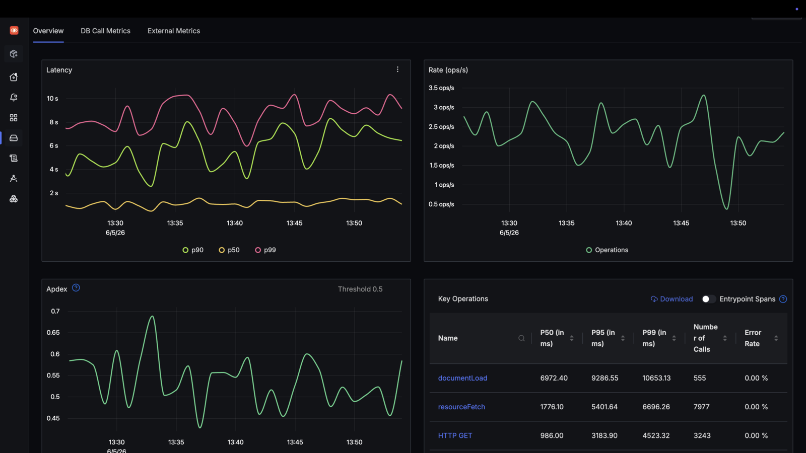
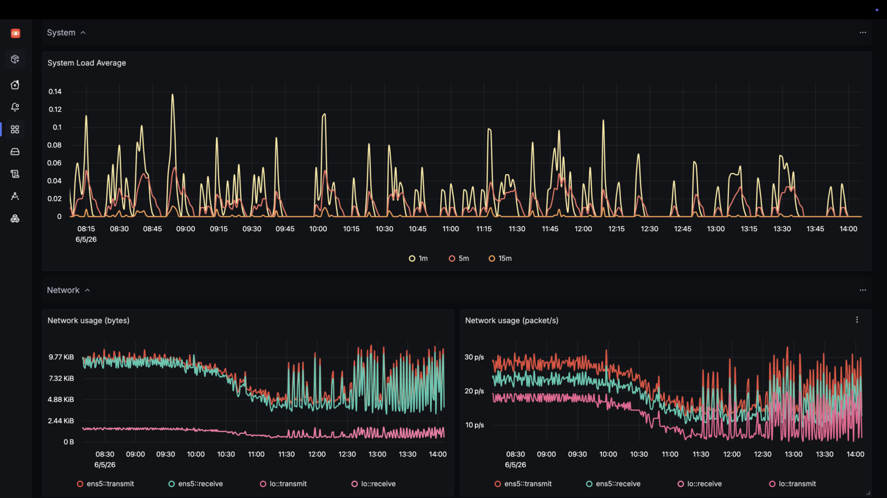
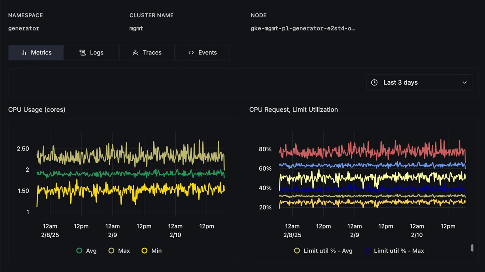
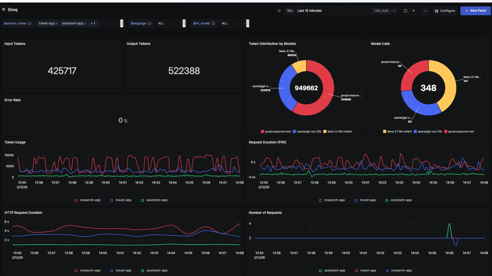
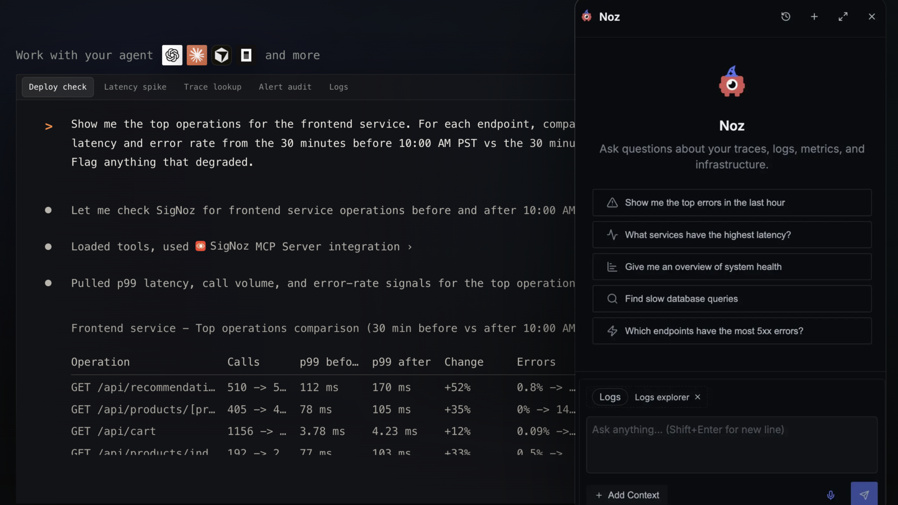
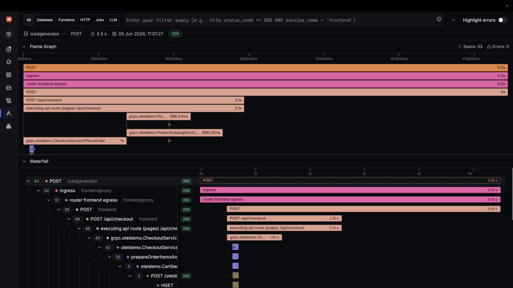
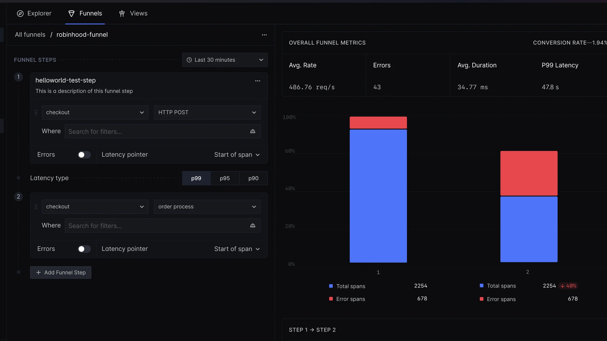

<div align="center">

# 📡 StreamPulse

### Real-Time Observability & Telemetry Platform for Streaming at Scale

*A mini-Datadog built for streaming architectures: ingest → store → detect → alert.*


**[🌐 Live Website & Interactive Demo](https://YOUR-SITE-LINK)** · **[📹 Video Walkthrough](#)** · **[📄 Architecture Deep-Dive](#-architecture)**

</div>

---

## 📖 Table of Contents
1. [Overview](#-overview)
2. [Why I Built This](#-why-i-built-this)
3. [Key Features](#-key-features)
4. [Architecture](#-architecture)
5. [Tech Stack (Detailed)](#-tech-stack-detailed)
6. [Data Pipeline & Kafka Topics](#-data-pipeline--kafka-topics)
7. [Anomaly Detection Engine](#-anomaly-detection-engine)
8. [Data Model](#-data-model)
9. [API Reference](#-api-reference)
10. [Distributed Tracing with OpenTelemetry](#-distributed-tracing-with-opentelemetry)
11. [Dashboard (React + TypeScript)](#-dashboard-react--typescript)
12. [Cloud & DevOps](#-cloud--devops)
13. [Performance & Load Testing](#-performance--load-testing)
14. [Getting Started](#-getting-started)
15. [Project Structure](#-project-structure)
16. [Testing & Quality](#-testing--quality)
17. [Security](#-security)
18. [Roadmap](#-roadmap)
19. [FAQ](#-faq)
20. [Author](#-author)

---

## 🧒 Overview

### In plain English
When millions of people watch a live match at the same time, a tiny failure can make videos buffer and viewers leave. **StreamPulse is a heartbeat monitor for video streaming.** It collects health signals from every part of a system, learns what "normal" looks like, and alerts engineers the moment something is abnormal, ideally before viewers notice.

### In technical terms
StreamPulse is a cloud-native **telemetry pipeline and anomaly-detection platform**. It ingests high-volume **metrics, logs and distributed traces** from simulated streaming microservices through a non-blocking Spring WebFlux gateway, streams them via **Kafka**, persists them in **TimescaleDB**, applies **statistical anomaly detection** in near real time, and surfaces everything in **Grafana** and a custom **React/TypeScript** dashboard built for on-call engineers.

## 🎯 Why I Built This

Live-streaming platforms must handle sudden, massive traffic spikes (a match kickoff, a season finale) while keeping latency low. Operating at that scale requires strong observability: you can't fix what you can't see.

I built StreamPulse to demonstrate, end to end, the skills that problem demands:

| Challenge in streaming | What StreamPulse demonstrates |
|---|---|
| Millions of concurrent viewers | Non-blocking, back-pressure-aware ingestion |
| Spiky traffic | Kafka buffering + horizontal autoscaling on Kubernetes |
| Hard-to-find failures | Distributed tracing across 15+ services |
| Alert fatigue | Adaptive Z-score detection instead of static thresholds |
| On-call stress | Accessible, focused dashboards |
| Reliability | IaC, CI/CD, health probes, SLO-style monitoring |

## ✨ Key Features

- ⚡ **High-throughput ingestion**: Reactive Spring WebFlux API with batching and back-pressure.
- 🔁 **Exactly-once streaming**: Kafka transactions and Kafka Streams processing.
- 🗄 **Time-series storage**: TimescaleDB hypertables, compression and continuous aggregates.
- 🧠 **Anomaly detection**: Rolling Z-score (Isolation Forest planned) with per-metric baselines.
- 🚨 **Smart alerting**: Prometheus Alertmanager routing to Slack/email/webhook with deduplication.
- 🔍 **Distributed tracing**: OpenTelemetry instrumentation, end-to-end request lifecycle visibility.
- 📜 **Log exploration**: ELK stack with structured JSON logs correlated to trace IDs.
- ✅ **Schema validation**: Automated checks on incoming telemetry to protect data quality.
- 🖥 **Real-time dashboard**: React/TypeScript, live updates over WebSocket/SSE, WCAG 2.1 AA.
- ☁️ **Production-style infra**: Terraform, EKS, GitHub Actions, Docker, Helm.
- 🎮 **Traffic simulator**: Generates realistic spikes, failures and latency regressions for demos and load tests.

## 🏗 Architecture



**Design principles**
1. **Non-blocking end to end**: no thread-per-request bottlenecks.
2. **Decoupled via Kafka**: producers never wait on storage or detection.
3. **Observe the observer**: StreamPulse monitors itself with Prometheus and OTel.
4. **Everything as code**: reproducible infrastructure and deployments.

## 🧰 Tech Stack (Detailed)

### Languages
| Language | Where it's used | Why |
|---|---|---|
| **Java 21** | Ingest, stream processing, anomaly engine | Virtual threads, records, pattern matching, mature ecosystem for streaming |
| **TypeScript** | React dashboard | Type safety for complex real-time UI state |
| **Python** *(optional)* | Offline Isolation Forest experiments | Rich ML tooling (scikit-learn) |
| **HCL** | Terraform | Declarative cloud infrastructure |
| **SQL** | TimescaleDB | Time-bucketed analytics |

### Backend
| Technology | Purpose |
|---|---|
| **Spring Boot 3** | Application framework, configuration, actuator health endpoints |
| **Spring WebFlux (Reactor)** | Non-blocking, high-concurrency HTTP ingestion with back-pressure |
| **Apache Kafka** | Durable, partitioned event backbone that absorbs traffic spikes |
| **Kafka Streams** | Windowed aggregations, joins and enrichment with exactly-once semantics |
| **Spring Data R2DBC** | Reactive database access |
| **Micrometer** | Application metrics exposed to Prometheus |

### Observability
| Technology | Purpose |
|---|---|
| **OpenTelemetry (SDK + Collector)** | Vendor-neutral instrumentation of metrics, traces and logs |
| **Prometheus** | Metrics scraping, alert rules, SLO tracking |
| **Alertmanager** | Alert routing, grouping, silencing, deduplication |
| **Grafana** | Operational dashboards and alert visualization |
| **Elasticsearch + Logstash + Kibana (ELK)** | Centralized log search and exploration |
| **Jaeger / Tempo** *(optional)* | Trace storage and waterfall visualization |

### Data & Caching
| Technology | Purpose |
|---|---|
| **TimescaleDB** | Time-series storage: hypertables, compression, continuous aggregates, retention policies |
| **Redis** | Hot-path caching of dashboard queries, rate limiting, alert dedup state |

### Frontend
| Technology | Purpose |
|---|---|
| **React 18 + TypeScript** | Component-based dashboard UI |
| **Vite** | Fast dev/build tooling |
| **Recharts / D3** | Live charts |
| **WebSocket / SSE** | Real-time data push |
| **Tailwind CSS** | Consistent, accessible styling |
| **Vitest + Testing Library + axe-core** | Unit and accessibility testing |

### Cloud & DevOps
| Technology | Purpose |
|---|---|
| **AWS EKS** | Managed Kubernetes cluster |
| **AWS S3** | Cold storage / archive for telemetry and Terraform state |
| **AWS SQS** | Dead-letter and async alert delivery queues |
| **Terraform** | Infrastructure as code (VPC, EKS, IAM, S3, SQS) |
| **Kubernetes + Helm** | Deployments, HPA autoscaling, probes |
| **Docker** | Containerization, local `docker compose` stack |
| **GitHub Actions** | CI/CD: build, test, scan, image push, deploy |

### Testing & Quality
**JUnit 5**, **Testcontainers** (Kafka/Postgres integration tests), **k6 / Gatling** (load testing), **SonarQube/Checkstyle**, **Trivy** (image scanning), **ESLint + Prettier**.

## 🔄 Data Pipeline & Kafka Topics

| Topic | Key | Purpose | Partitions |
|---|---|---|---|
| `telemetry.metrics.raw` | service-id | Raw metric events | 12 |
| `telemetry.logs.raw` | service-id | Structured logs | 12 |
| `telemetry.traces.raw` | trace-id | Span events | 12 |
| `telemetry.metrics.agg` | metric+window | Windowed aggregates | 6 |
| `alerts.anomalies` | metric | Detected anomalies | 3 |
| `telemetry.dlq` | n/a | Invalid / failed events | 3 |

**Reliability:** idempotent producers, transactional processing, consumer-group rebalancing, dead-letter topic for schema-invalid events.

## 🧠 Anomaly Detection Engine

StreamPulse uses a **rolling Z-score** per metric (per service and region) so the baseline adapts to normal changes in traffic instead of relying on fixed thresholds.

```
z = (x − μ) / σ        →  alert when |z| > 3   (configurable)
```

```java
public record Baseline(double mean, double stdDev) {}

public Optional<Anomaly> evaluate(String metric, double value, Window window) {
    Baseline b = window.baseline();                 // rolling mean & std-dev
    if (b.stdDev() == 0) return Optional.empty();   // avoid divide-by-zero
    double z = (value - b.mean()) / b.stdDev();
    return Math.abs(z) > threshold
        ? Optional.of(new Anomaly(metric, value, z, Instant.now()))
        : Optional.empty();
}
```

**False-alarm reduction techniques**
- Minimum window size (warm-up) before alerting
- Consecutive-breach requirement (e.g. 3 of 5 points)
- Alert grouping and deduplication in Alertmanager
- Per-metric sensitivity tuning

**Planned:** Isolation Forest for multivariate anomalies, seasonality-aware baselines.

## 🗃 Data Model

```sql
CREATE TABLE metrics (
  time        TIMESTAMPTZ NOT NULL,
  service     TEXT        NOT NULL,
  region      TEXT,
  name        TEXT        NOT NULL,
  value       DOUBLE PRECISION NOT NULL,
  labels      JSONB
);
SELECT create_hypertable('metrics', 'time');

-- 1-minute rollups for fast dashboards
CREATE MATERIALIZED VIEW metrics_1m
WITH (timescaledb.continuous) AS
SELECT time_bucket('1 minute', time) AS bucket, service, name,
       avg(value) AS avg, max(value) AS max,
       percentile_cont(0.99) WITHIN GROUP (ORDER BY value) AS p99
FROM metrics GROUP BY bucket, service, name;

SELECT add_compression_policy('metrics', INTERVAL '7 days');
SELECT add_retention_policy('metrics',  INTERVAL '90 days');
```

## 🔌 API Reference

| Method | Endpoint | Description |
|---|---|---|
| `POST` | `/v1/ingest/metrics` | Batch-ingest metric events |
| `POST` | `/v1/ingest/logs` | Batch-ingest structured logs |
| `POST` | `/v1/ingest/traces` | Ingest spans (OTLP/HTTP also supported) |
| `GET` | `/v1/query/metrics?name=&service=&from=&to=` | Query time-series data |
| `GET` | `/v1/alerts?status=firing` | List active alerts |
| `GET` | `/v1/traces/{traceId}` | Fetch full trace |
| `GET` | `/actuator/health` | Liveness / readiness |
| `GET` | `/actuator/prometheus` | Prometheus scrape endpoint |

```bash
curl -X POST http://localhost:8080/v1/ingest/metrics \
  -H "Content-Type: application/json" \
  -d '[{"service":"playback-api","name":"latency_ms","value":42.5,"ts":"2026-01-01T12:00:00Z"}]'
```

## 🔍 Distributed Tracing with OpenTelemetry

- Auto-instrumentation via the OTel Java agent across **15+ simulated services**
- W3C `traceparent` context propagation over HTTP and Kafka headers
- Trace IDs injected into logs, so you can jump from a log line to its full trace
- Example request path traced: `Gateway → Auth → Playback → Entitlements → CDN Selector → Manifest Service`

```yaml
# otel-collector.yaml (excerpt)
receivers:
  otlp: { protocols: { grpc: {}, http: {} } }
processors:
  batch: {}
exporters:
  kafka: { topic: telemetry.traces.raw }
  prometheus: { endpoint: "0.0.0.0:8889" }
```

## 🖥 Dashboard (React + TypeScript)

- Live service-health overview with real-time charts
- Alert timeline and incident drill-down
- Log explorer with trace correlation
- Dark mode and keyboard-first navigation
- **Accessibility:** WCAG 2.1 AA: color-contrast safe palettes, ARIA live regions for alerts, full keyboard support, automated `axe-core` checks in CI

## ☁️ Cloud & DevOps

**Terraform modules:** `vpc`, `eks`, `iam`, `s3`, `sqs`.

```bash
cd infra/terraform
terraform init && terraform plan && terraform apply
```

**Kubernetes:** Helm charts per service, Horizontal Pod Autoscaler on CPU and custom Kafka-lag metrics, readiness/liveness probes, resource limits, PodDisruptionBudgets.

**CI/CD (GitHub Actions)**
```
push → build & unit tests → Testcontainers integration tests → lint/SAST
     → Docker build & Trivy scan → push image → deploy to EKS (on main)
```

## 📊 Performance & Load Testing

> ⚠️ The values below are **targets**. Replace them with your **measured results** (k6/Gatling) and include screenshots in `/docs/benchmarks`.

| Metric | Target | Measured |
|---|---|---|
| Sustained throughput | 50,000+ events/sec | _fill in_ |
| p99 ingestion latency | < 50 ms | _fill in_ |
| Availability (test window) | 99.9% | _fill in_ |
| MTTD vs. static thresholds | ~45% faster | _fill in_ |
| False alarms vs. static thresholds | ~60% fewer | _fill in_ |

```bash
k6 run load-tests/ingest-50k.js
```

## 🚀 Getting Started

**Prerequisites:** Java 21, Node 20+, Docker & Docker Compose, (optional) Terraform, kubectl.

```bash
# 1. Clone
git clone https://github.com/YOUR-USER/streampulse.git && cd streampulse

# 2. Start infrastructure (Kafka, TimescaleDB, Redis, Prometheus, Grafana, ELK)
docker compose up -d

# 3. Run backend services
./mvnw clean install
./mvnw -pl ingest-service spring-boot:run

# 4. Run the dashboard
cd dashboard && npm install && npm run dev

# 5. Start the traffic simulator
./mvnw -pl simulator spring-boot:run -Dsim.rate=50000 -Dsim.spike=true
```

| Service | URL |
|---|---|
| Dashboard | http://localhost:3000 |
| Ingest API | http://localhost:8080 |
| Grafana | http://localhost:3001 |
| Prometheus | http://localhost:9090 |
| Kibana | http://localhost:5601 |

## 📁 Project Structure

```
streampulse/
├── ingest-service/        # WebFlux ingestion API
├── stream-processor/      # Kafka Streams topology
├── anomaly-engine/        # Z-score detection + alert publisher
├── query-api/             # Reactive query layer + Redis cache
├── simulator/             # Synthetic traffic & failure generator
├── dashboard/             # React + TypeScript UI
├── infra/
│   ├── terraform/         # AWS IaC
│   ├── helm/              # Kubernetes charts
│   └── observability/     # Prometheus, Grafana, OTel, ELK configs
├── load-tests/            # k6 / Gatling scripts
├── docs/                  # Architecture, benchmarks, screenshots
└── .github/workflows/     # CI/CD
```

## 🧪 Testing & Quality
- Unit tests (JUnit 5, Vitest) with coverage reporting
- Integration tests with Testcontainers (real Kafka and Postgres)
- Contract tests for ingestion schemas
- Accessibility tests (axe-core) and load tests in CI

## 🔐 Security
- API-key / JWT auth on ingestion endpoints
- Rate limiting via Redis
- Secrets via AWS Secrets Manager / Kubernetes Secrets (never committed)
- Least-privilege IAM roles; container image scanning with Trivy

## 🗺 Roadmap
- [x] Ingestion, Kafka pipeline, TimescaleDB storage
- [x] Z-score anomaly detection and alerting
- [x] React dashboard and interactive web demo
- [ ] Isolation Forest (multivariate) detection
- [ ] SLO / error-budget burn-rate alerts
- [ ] Multi-region failover
- [ ] Natural-language incident summaries

## ❓ FAQ

**Is this production-ready?** It's a portfolio-grade system built with production patterns. Scale claims depend on the cluster size and measured load tests above.

**Is the data real?** No. A simulator generates realistic streaming traffic, spikes and failures.

**Why Z-score?** It is simple, explainable and fast, which makes it a strong baseline before moving to ML models.

## 👤 Author

**Your Name**
[LinkedIn](#) · [Portfolio](https://YOUR-SITE-LINK) · [GitHub](#) · you@email.com

⭐ If you found this project interesting, please star the repo!

## 📄 License
MIT © Your Name

### What can you monitor?

SigNoz helps teams debug production issues faster by connecting logs, metrics, traces, alerts, dashboards, exceptions, and agent-native workflows in one place.

#### APM Overview

Monitor service latency, error rate, throughput, Apdex, top endpoints, database calls, and external calls.

<p align="center">
  
</p>

Learn more: [APM documentation](https://signoz.io/docs/instrumentation/overview/)

#### Log Management

Ingest, search, aggregate, and correlate logs with traces and metrics using a visual query builder.

<p align="center">
  
</p>

Learn more: [Log management documentation](https://signoz.io/docs/logs-management/overview/)

#### Metrics and Dashboards

Build dashboards for application, infrastructure, and custom metrics using Query Builder, PromQL, or ClickHouse SQL.

<p align="center">
  
</p>

Learn more: [Metrics documentation](https://signoz.io/docs/metrics-management/overview/)

#### Infrastructure Monitoring

Monitor Kubernetes clusters, pods, nodes, workloads, and host-level CPU, memory, disk, network, logs, and traces.

<p align="center">
  
</p>

Learn more: [Infrastructure monitoring documentation](https://signoz.io/docs/infrastructure-monitoring/overview/)

#### LLM and AI Observability

Trace LLM apps, RAG pipelines, prompts, tool calls, tokens, latency, and costs alongside application and infrastructure telemetry.

<p align="center">
  
</p>

Learn more: [LLM observability documentation](https://signoz.io/docs/llm-observability/)

#### Agent-Native Observability and MCP

Use the SigNoz MCP server to bring telemetry into coding agents, or use Noz inside SigNoz to investigate incidents, tune alerts, and build dashboards with production context. [Noz](https://signoz.io/docs/ai/noz/) is available only on SigNoz Cloud.

<p align="center">
  
</p>

Learn more: [SigNoz MCP server docs](https://signoz.io/docs/ai/signoz-mcp-server/) · [Agent skills docs](https://signoz.io/docs/ai/agent-skills/#install-the-plugin)

#### Distributed Tracing

Follow requests across services with flamegraphs, waterfalls, span events, filters, and trace analytics.

<p align="center">
  
</p>

Learn more: [Distributed tracing documentation](https://signoz.io/docs/instrumentation/)

#### Trace Funnels

Create funnels from traces to understand request-flow drop-offs, failed transitions, and systemic workflow issues.

<p align="center">
  
</p>

Learn more: [Trace funnels documentation](https://signoz.io/docs/trace-funnels/overview/)

Also monitor: [**exceptions**](https://signoz.io/docs/userguide/exceptions/), [**alerts**](https://signoz.io/docs/alerts/), [**external APIs**](https://signoz.io/docs/external-api-monitoring/overview/), and [**integrations**](https://signoz.io/docs/integrations/integrations-list/) for OpenTelemetry, Prometheus, Kubernetes, cloud providers, language SDKs, application frameworks, databases, and LLM tools.

### Why teams use SigNoz

1. **OpenTelemetry-native**<br>
   Instrument once with open standards and keep ownership of your telemetry.
2. **Correlated signals**<br>
   Move from service charts to traces, logs, infra metrics, and exceptions without switching tools.
3. **Single columnar database**<br>
   Built for high-cardinality, high-volume observability workloads.
4. **Predictable pricing**<br>
   No per-host pricing, no user-seat pricing, and no special pricing for custom metrics.
5. **Enterprise ready**<br>
   SOC 2 Type II and HIPAA compliance, RBAC, ingestion controls, custom retention, support, BYOC, and self-hosting.

### Getting started

#### Start on Cloud

Create a managed SigNoz workspace and get your first dashboard without running observability infrastructure.

[**Start free on SigNoz Cloud**](https://signoz.io/teams/)

#### Self-host SigNoz

Run SigNoz in your own infrastructure with Foundry, Docker, Kubernetes, or Linux.

[**Foundry**](https://github.com/SigNoz/foundry) · [**Docker**](https://signoz.io/docs/install/docker/) · [**Kubernetes**](https://signoz.io/docs/install/kubernetes/) · [**Linux**](https://signoz.io/docs/install/linux/)

#### Send data

Instrument applications and infrastructure with OpenTelemetry, Prometheus, language SDKs, and integrations.

[**Instrumentation**](https://signoz.io/docs/instrumentation/) · [**Integrations**](https://signoz.io/docs/integrations/integrations-list/)

### Comparisons to familiar tools

SigNoz is often adopted by teams moving from a stack of single-purpose tools or commercial platforms with unpredictable pricing.

**Prometheus**<br>
Good if you just need metrics. SigNoz keeps metrics, logs, traces, dashboards, and alerts together so teams can debug with correlated context.

**Jaeger**<br>
Jaeger only does distributed tracing. SigNoz adds metrics, logs, trace analytics, dashboards, alerts, exceptions, and trace-to-log workflows.

**Elastic**<br>
SigNoz uses columnar database for efficient observability analytics and high-cardinality log workloads, with 50% lower resource requirement compared to Elastic during ingestion. Check the [detailed study](https://signoz.io/blog/logs-performance-benchmark/?utm_source=github-readme&utm_medium=logs-benchmark).

**Loki**<br>
In the linked benchmark, SigNoz indexed all keys in the test setup, while Loki hit max stream errors when more labels were added. Check the [detailed study](https://signoz.io/blog/logs-performance-benchmark/?utm_source=github-readme&utm_medium=logs-benchmark).

## Contributing

We ❤️ contributions big or small. Please read [CONTRIBUTING.md](CONTRIBUTING.md) to get started with making contributions to SigNoz.

Not sure how to get started? **Just ping us on `#contributing` in our [slack community](https://signoz.io/slack).**

As always, thanks to our amazing contributors!

<a href="https://github.com/signoz/signoz/graphs/contributors">
  
</a>
